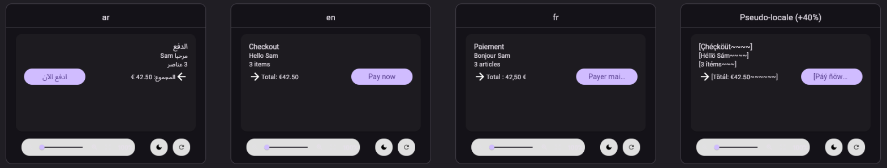

# Flutter Localization (ARB, gen-l10n)

Find the text in your Flutter app that is not translated yet, move it to your ARB files with one quick fix,
see every translation without leaving the code, and preview your widgets in every language. Works with Flutter's built-in **gen-l10n**, and with projects
still on **intl_utils / Flutter Intl**, which is discontinued.

## Features

**Hardcoded strings are reported.** Text the user reads (`Text`, `SelectableText`, `TextSpan`, and arguments
such as `labelText`, `hintText`, `helperText`, `errorText`, `tooltip`, `title`, `semanticLabel`) shows up in the
Problems panel. Map keys, routes, asset paths, logs and identifiers are left alone. Put `// l10n-ignore` on the
line, or the line above, to skip a string on purpose.

**Extract to ARB in one step.** Use the quick fix (`Cmd+.` / `Ctrl+.`), the context menu, or `Cmd+Alt+E` /
`Ctrl+Alt+E` on any string. You get a key suggestion, and then:

```dart
const Text('Hello $name')
```

becomes

```dart
Text(AppLocalizations.of(context)!.helloName(name))
```

with `"helloName": "Hello {name}"` and its placeholder added to your template ARB. The `const` that would no
longer compile is removed, the import is added once, and text that already has a key reuses it.

**Regenerated on save.** Saving an ARB file runs `flutter gen-l10n` (or the generator your project uses), so the
new getter exists right away.

**Translations on hover.** Hover over `.helloName` to see the text in every locale, with missing ones marked.

**Missing translations.** Each locale's ARB file shows which keys the template has and it does not.

**Preview a widget in every locale.** On a widget class, choose **Preview in all locales** from the light bulb or
the context menu. The extension adds

```dart
@LocalePreview()
Widget checkoutCardLocalePreview() => const CheckoutCard();
```

and the Flutter Widget Previewer shows the widget once per supported locale, once right to left (when no
supported locale is already) and once in a pseudo-locale: every message accented and 40% longer, in brackets, so
clipped and overflowing text shows up before any translation exists.



`LocalePreview` lives in `locale_preview.dart` next to your generated localizations and is rewritten whenever they
are regenerated. It takes `group`, `size` and `pseudo: false`. Previews need Flutter 3.38 or later.

## Supported setups

| Your project | Detected by | Inserted code |
|---|---|---|
| gen-l10n | `l10n.yaml` | `AppLocalizations.of(context)!.key` (class name, `nullable-getter` and output folder read from `l10n.yaml`) |
| flutter_localisation package | `flutter_localisation` dependency | `context.tr.key` |
| intl_utils / Flutter Intl | `flutter_intl:` in `pubspec.yaml` | `S.of(context).key` |

Prefer your own accessor, like a `context.l10n` extension? Set `flutterL10n.accessor` to `context.l10n.{key}`.

No `l10n.yaml` yet? Extracting the first string offers to create one.

## Moving off Flutter Intl

intl_utils, the generator behind the Flutter Intl extension, is marked discontinued on pub.dev. This extension
keeps working on intl_utils projects, and the **Migrate from Flutter Intl** command opens a step-by-step guide to
gen-l10n that keeps your `S` class and ARB files.

## Settings

| Setting | Default | |
|---|---|---|
| `flutterL10n.hardcodedStrings.severity` | `information` | `off`, `hint`, `information` or `warning` |
| `flutterL10n.generateOnSave` | `true` | Regenerate when an ARB file is saved or a string is extracted |
| `flutterL10n.flutterPath` | | flutter executable; defaults to the Dart extension's SDK, then `flutter` on the PATH |
| `flutterL10n.accessor` | | Custom expression with `{key}` |
| `flutterL10n.addMetadata` | `false` | Write `@key` for every string, not only those with placeholders |
| `flutterL10n.missingTranslations` | `true` | Warn about keys missing from a locale |

## Translating

The extension never sends your strings anywhere. To translate them, use your own workflow, or
[FlutterLocalisation](https://flutterlocalisation.com): the **Translate and Sync** command runs its free `fl`
command line tool, which AI-translates new keys into every locale and pulls the ARB files back.

## Feedback

Issues and ideas: [github.com/tajaouart/flutterlocalisation-vscode](https://github.com/tajaouart/flutterlocalisation-vscode/issues).
